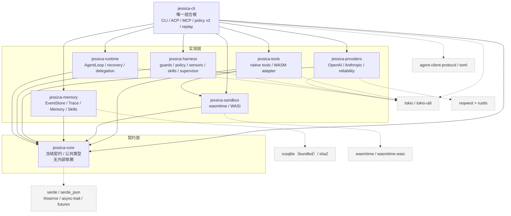
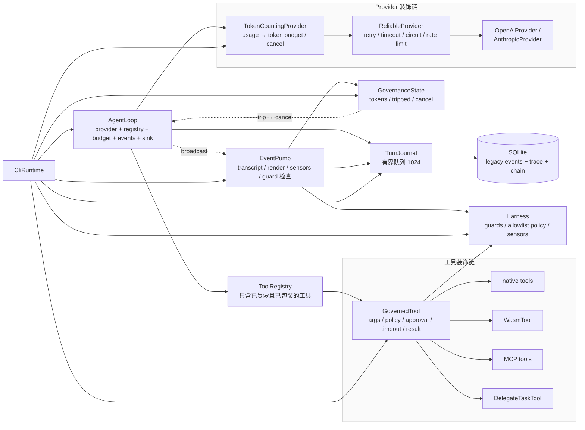
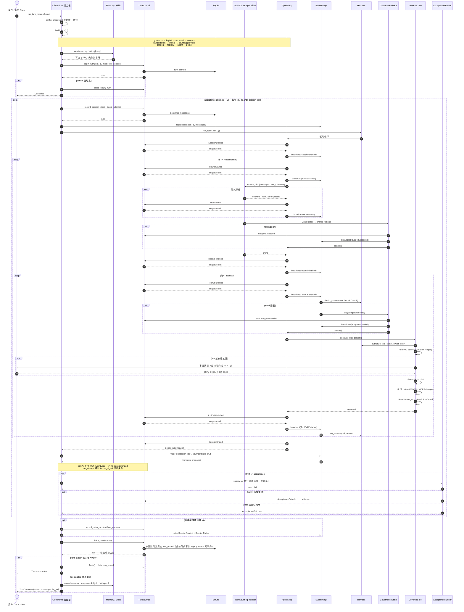

# Jessica 架构（当前实现）

> 状态快照：2026-11-23，对应 workspace 版本 `0.11.0`。
>
> 本文只描述**已经落地并可验收**的架构，不描述未来计划。`README.md` 面向使用与行为说明，`PLAN.md` 面向任务与进度，本文面向代码结构与运行时数据流。若三者冲突，以代码与验收测试为准。

---

## 1. 系统定位

Jessica 是一个确定性 Rust Agent 运行时，核心目标不是让模型“自述做了什么”，而是让每一次执行都留下可验证的轨迹：

- **确定性内核**：Agent 循环、预算、恢复、回放和策略判定不依赖模型自述。
- **可验证轨迹**：事件以 append-only 方式持久化，并带版本化 trace、SHA-256 链和导出摘要。
- **能力最小化**：工具是否暴露由宿主决定；执行前经过 allowlist、参数级策略、审批、超时和结果边界。
- **冻结契约层**：`jessica-core` 只定义跨层契约，不引入 WASM、数据库、HTTP 等实现概念。
- **实现层可替换**：Provider、存储、沙箱、工具和前端传输都在契约之外演进。

一句话概括：

```
模型提出意图，宿主决定能否执行；运行时只产生结构化事件，证据链负责证明发生过什么。
```

---

## 2. 架构全景

```text
┌──────────────────────────────────────────────────────────────────────┐
│ 前端 / 调用方                                                         │
│   CLI one-shot · REPL · jessica acp（stdio JSON-RPC）· replay 等子命令 │
└───────────────────────────────┬──────────────────────────────────────┘
                                │
┌───────────────────────────────▼──────────────────────────────────────┐
│ jessica-cli：组合根（composition root）                               │
│                                                                      │
│  config ──► provider ──► EventRecorder ──► wasm / memory / skills     │
│                    │                                                  │
│                    ├── ToolCatalog（native / wasm / mcp / delegation）│
│                    ├── GovernedTool 包装链                            │
│                    ├── TurnJournal（producer-side durable sink）      │
│                    └── EventPump（渲染 / transcript / sensors）       │
└───────────────────────────────┬──────────────────────────────────────┘
                                │
┌───────────────────────────────▼──────────────────────────────────────┐
│ jessica-runtime：AgentLoop                                            │
│   模型流 ──► 工具调用 ──► 工具结果 ──► 下一轮 ──► 终止原因             │
│   同时广播 AgentEvent；可选 EventSink 在广播前持久化                   │
└───────────────┬───────────────────────────────┬──────────────────────┘
                │                               │
┌───────────────▼──────────────┐  ┌─────────────▼──────────────────────┐
│ jessica-providers            │  │ 工具实现层                          │
│ OpenAI-compatible / Anthropic│  │ native · WASM · MCP · delegation    │
│ + reliability wrapper        │  │ jessica-sandbox / jessica-tools     │
└──────────────────────────────┘  └────────────────────────────────────┘
                │
┌───────────────▼──────────────────────────────────────────────────────┐
│ jessica-harness                                                       │
│ Guard · Policy · Sensor · Hook · Acceptance · Supervisor · Skills     │
└───────────────────────────────┬──────────────────────────────────────┘
                                │
┌───────────────────────────────▼──────────────────────────────────────┐
│ jessica-memory                                                        │
│ SQLite EventStore / TraceStore / TraceChain / Memory / Skill 存储     │
└──────────────────────────────────────────────────────────────────────┘

除 `jessica-tools → jessica-sandbox` 和 `jessica-cli → 全部实现层` 外，实现层只依赖 jessica-core；jessica-cli 负责最终装配。
```

---

## 3. Workspace 与依赖方向

Workspace 使用 `resolver = "2"`，版本单一来源为根 `Cargo.toml` 的 `[workspace.package] version = "0.11.0"`。

| Crate | 角色 | 允许的内部依赖 | 关键实现依赖 |
| --- | --- | --- | --- |
| `jessica-core` | 冻结契约与公共类型 | 无 | `serde`、`serde_json`、`thiserror`、`async-trait`、`futures` |
| `jessica-runtime` | Agent 循环、恢复、单层委派 | `jessica-core` | `tokio`、`tokio-util` |
| `jessica-sandbox` | wasmtime / WASI 沙箱 | `jessica-core` | `wasmtime`、`wasmtime-wasi` |
| `jessica-harness` | Middleware、Guard、Policy、Sensor、Acceptance、Skills、Supervisor | `jessica-core` | `tokio`、`tracing` |
| `jessica-providers` | OpenAI 兼容 / Anthropic Provider 与可靠性层 | `jessica-core` | `reqwest`、`tokio` |
| `jessica-tools` | 原生工具与 WASM 工具适配 | `jessica-core`、`jessica-sandbox` | `tokio` |
| `jessica-memory` | 事件溯源、trace 存储、分层记忆、技能库 | `jessica-core` | `rusqlite`、`sha2`、`tokio` |
| `jessica-cli` | 可执行入口、全部实现装配、ACP | 所有实现层 | `agent-client-protocol`、`toml`、`tokio` |

依赖规则：

- 任何内部依赖只能指向更低层，禁止反向或循环依赖。
- `jessica-core` 不依赖任何内部 crate，也不引入 wasmtime、SQLite、HTTP 客户端或 ACP。
- `jessica-runtime`、`jessica-sandbox`、`jessica-harness` 只依赖 `jessica-core`。
- `jessica-tools` 自 Task 3.3 起可依赖 `jessica-sandbox`。
- `jessica-cli` 是唯一组合根，拥有 provider、数据库、MCP、ACP 和配置等进程级资源。

这条依赖线不是形式要求，而是为了保证：

1. 沙箱、存储、网络等重能力无法通过核心契约泄漏到上层；
2. `jessica-core` 的公共 API 可以冻结，实现层可以独立演进；
3. 测试可以用纯契约 mock 验证运行时，而不必启动完整进程。

### 3.1 Crate 级依赖图

箭头方向表示依赖方向：实线为内部依赖，虚线为外部重依赖。



图中三条关键性质：

- `jessica-core` 只依赖轻量契约与序列化库，不接触 wasmtime、SQLite、HTTP 或 ACP。
- 实现层之间只有一条合法内部边：`jessica-tools → jessica-sandbox`。
- `jessica-cli` 是唯一汇合点，拥有全部实现层和进程级资源。

---

## 4. `jessica-core`：冻结契约层

`jessica-core` 用 `#![deny(missing_docs)]` 约束公共 API。模块划分如下：

| 模块 | 内容 |
| --- | --- |
| `types` | `SessionId`、`Message`、`Role`、`ToolCall`、`ToolResult`、`TokenUsage`、`Budget`、`SessionEndReason`、`PermissionDecision`、`AgentEvent` |
| `llm` | `LlmProvider`、`LlmEvent`、`LlmError`、流式响应契约 |
| `tool` | `Tool`、`ToolSchema`、`ToolRegistry` |
| `guard` | `Guard`、`GuardContext`、`GuardDecision` |
| `policy` | `Policy`、`PolicyDecision`、默认 `DenyAll` |
| `sensor` | `Sensor`、`SensorContext` |
| `hook` | `Hook` 生命周期观察接口 |
| `acceptance` | `AcceptanceCheck`、`AcceptanceContext`、`AcceptanceResult` |
| `events` | `EventSink`、`EventSinkError` |
| `memory` | `MemoryStore`、`MemoryEntry`、`MemoryError` |
| `trace` | `TurnId`、`TraceEvent`、`TracePayload`、schema 版本常量 |

### 4.1 核心 Trait 的行为边界

- `LlmProvider::stream_chat` 返回 `BoxStream<LlmEvent>`；实现负责网络和流式解析，运行时只消费文本增量、工具调用请求、用量和错误。
- `Tool` 同时支持按参数执行和 `execute_with_call`；AgentLoop 负责给结果盖上原始 tool call id，避免工具实现伪造关联。
- `Guard` 是纯判定函数：不调用模型、不做 I/O、不读墙钟。有状态 Guard（如 stuck detection）由宿主按会话/轮次构造。
- `Policy` 只有 allow/deny 两态；三态策略（deny/ask/allow）属于 CLI 宿主层的 `PolicyV2`，不进入冻结契约。
- `Sensor` 在工具结果产生后运行；`Hook` 在生命周期节点运行。两者都是扩展点，不决定内核循环结构。
- `EventSink` 位于广播之前：生产者必须先 `emit` 成功，再广播事件；sink 失败必须终止本轮，而不是静默丢事件。

### 4.2 事件模型

`AgentEvent` 是跨层可观察事实的唯一载体，当前包含：

- 会话：`SessionStarted`、`SessionEnded`
- 模型轮次：`RoundStarted`、`RoundFinished`
- 文本：`ModelDelta`
- 工具：`ToolCallStarted`、`ToolCallFinished`
- 治理：`PolicyDenied`、`PermissionDecided`、`BudgetExceeded`
- 验收：`AcceptanceFailed`
- 委派：`ChildSessionStarted`、`ChildSessionEnded`
- 错误：`Error`

事件必须可序列化，因为事件存储会逐字节保存其 JSON 表示。`SessionStarted` 携带 bootstrap messages；这是恢复与回放能够重建完整对话的原因之一。

`SessionEndReason` 固定为 `Completed`、`Cancelled`、`BudgetExceeded`、`AcceptanceFailed`、`Error`。运行时只返回终止原因，不返回完整对话；完整对话由事件流重建。

---

## 5. `jessica-runtime`：确定性 Agent 循环

### 5.1 AgentLoop 的职责

`AgentLoop` 持有：

- `Arc<dyn LlmProvider>`
- `Arc<ToolRegistry>`
- `Budget`
- `broadcast::Sender<AgentEvent>`
- 可选 `EventSink`

它不持有配置、不读环境变量、不打开数据库、不知道 UI、不执行策略。所有治理都在外层。

一次正常会话的事件顺序：

```text
SessionStarted
  RoundStarted
  ModelDelta*
  RoundFinished
  ToolCallStarted* → ToolCallFinished*   （该轮请求的工具，逐批执行）
  RoundStarted
  ...
SessionEnded
```

若发生预算或错误，终止事件之前会先出现 `BudgetExceeded` 或 `Error`。

关键行为：

- **先完成模型轮次，再执行工具**：`RoundFinished` 在工具执行前发出，保证即使工具被中断，token 用量也不会丢失。
- **未知工具不 panic**：返回失败的 `ToolResult`，模型可以自行纠正。
- **取消协作式**：等待模型和等待工具时都检查 `CancellationToken`。
- **最大轮次**：预算耗尽时停止循环并给出 `BudgetExceeded`。
- **事件落盘优先**：配置了 sink 时，每个事件先交给 sink，成功后才广播；sink 失败会停止整轮。
- **结构化计数**：`run_with_transcript` 返回 `rounds`、`tool_calls`、`tool_errors`、`first_tool_error`、`error`、`tool_call_limit_hit` 等，验收和技能信号不依赖模型文本。

### 5.2 恢复（resume）

`recover_session` 是对 `RecordedEvent` 的纯 reducer：

- 不重新调用模型，不重新执行工具；
- 从 bootstrap messages 和事件流重建消息、已完成轮数和终止原因；
- 只接受稳定检查点：模型轮次中间、工具调用与结果之间都不允许恢复，避免猜测缺失工作；
- v2 事件流使用显式 `RoundStarted`；只有 v1 流才退回文本/工具启发式计数；
- `AgentLoop::resume` 从检查点继续，并扣除已经使用的轮次预算。

因此 `--resume` 是“继续未完成的工作”，不是“重放并重新产生副作用”。

### 5.3 委派契约

`jessica-runtime` 同时定义单层子 Agent 的结构边界：

- `ParentCapabilities`：父会话的 allowlist 与原生工具集合。
- `narrow_tools`：请求必须是父工具集合的子集；结果只保留原生工具，并始终移除 `delegate_task`，因此不能嵌套委派。
- `AgentChildExecutor`：每次委派重建工具注册表和子对话；子 Agent 是裸 `AgentLoop`，没有 harness、记忆、技能、传感器或验收。
- `DelegateTaskTool`：把子 Agent 结果渲染为父模型可见的 JSON 结果。
- 子 Agent 共享父 provider 和父 token budget；子调用可以触发父轮次取消。
- 子事件可选送入 `ChildEventSink` 作为 trace 证据，但不会写入父会话的 legacy 事件流。

WASM 工具不会传给子 Agent：v1 没有隔离的子 WASM 实例，共享 guest 状态会破坏隔离性。

---

## 6. `jessica-harness`：治理与中间件

Harness 不接管 AgentLoop，而是在同一事件流旁边提供确定性检查点。

### 6.1 Harness 组成

`Harness` 持有：

- `Vec<Arc<dyn Hook>>`
- `Vec<Arc<dyn Guard>>`
- `Arc<dyn Policy>`（默认 `DenyAll`）
- `SensorPipeline`
- 事件广播通道

提供：

- `check_guards`：按注册顺序返回第一个超限事件；
- `authorize_tool_call`：返回 allow 或结构化的 `PolicyDenied`；
- `run_sensors`：工具结果后按顺序运行全部 Sensor；
- `run`：在 AgentLoop 运行期间按顺序调用 Hook；Guard、Policy 和 Sensor 是调用方在明确检查点触发的，不由 `run` 隐式轮询。

CLI 当前以空 hooks 构造 Harness；Hook 是保留的扩展点，不是现有治理链的必需环节。

### 6.2 四类 Guard

| Guard | 判定依据 | 超限结果 |
| --- | --- | --- |
| `TokenBudgetGuard` | 累计 prompt + completion tokens | `BudgetKind::TokenLimit` |
| `ToolTimeoutGuard` | 工具实测耗时 | `BudgetKind::ToolTimeout` |
| `StuckDetectionGuard` | 连续无进展轮次（无工具、输出未变化） | `BudgetKind::Stuck` |
| `ResultSizeGuard` | 工具结果字节数 | `BudgetKind::ResultSize` |

Guard 的顺序是确定性的；多个条件同时满足时，第一个注册的 Guard 获胜，避免“哪个计时器先到”造成不确定结果。

### 6.3 策略与传感器

- `AllowlistPolicy` 是默认策略：未显式列出的工具一律拒绝；空 allowlist 等价于 deny all。
- `CommandSensor` 在每次工具结果后运行宿主命令，受 supervisor 的环境、超时和输出上限约束。
- 传感器失败不会跳过后续传感器；报告保留每个传感器的结果和顺序。

### 6.4 验收

`AcceptanceRunner` 负责验收重试编排：

- 每轮尝试复用累计对话；
- 验收失败时注入 `AcceptanceFailed` 反馈；
- 重试次数由配置限定；
- CLI 每次尝试创建新的 session id，但共享同一个 `TurnId`；
- 最终终止原因由验收编排决定，预算 trip 可以覆盖运行时的 `Completed`。

`CommandAcceptanceCheck` 通过 supervisor 执行验收命令，不继承凭据环境。

### 6.5 执行 supervisor

`jessica-harness::supervisor` 统一约束所有宿主命令：

- 子进程从空环境开始，只继承默认白名单 `PATH`、`HOME`、`LANG`、`TERM`、`TMPDIR`；
- 配置只能追加变量，不能移除默认变量；
- 凭据相关变量（Provider key、云凭据、SCM token、SSH、动态链接器注入变量等）在加载和执行两处都被过滤；
- 一个总 deadline 覆盖 spawn、读管道、等待退出；
- stdout / stderr 分别限制字节数，超限截断并记录原始长度；
- `kill_on_drop` 保证直接子进程在 future 被丢弃时被杀掉。

当前**没有**进程组清理和 rlimit；这是已记录的边界，不是隐含能力。

---

## 7. `jessica-cli`：组合根与一轮执行

### 7.1 CLI 模式

| 模式 | 入口 | 是否装配运行时 | 说明 |
| --- | --- | --- | --- |
| 默认 / `--resume` | `Mode::Turn` | 是 | one-shot 或 REPL；`--resume` 继续中断会话 |
| `replay` | `Mode::Replay` | 否 | 离线确定性回放，输出 JSONL |
| `skills` | `Mode::Skills` | 仅技能库 | 列表、激活、停用、查看等 |
| `tools` | `Mode::Tools` | 否 | catalog 检查，不创建 `.jessica` |
| `policy` | `Mode::Policy` | 否 | 对合成调用模拟策略判定，不执行工具 |
| `trace` | `Mode::Trace` | 否 | 只读验证、摘要、导出、离线验证 bundle |
| `config` | `Mode::Config` | 否 | 输出 effective config JSON |
| `acp` | `Mode::Acp` | 是（惰性） | 稳定 ACP v1 stdio 服务 |

只读子命令刻意不初始化 provider、事件库、记忆库、技能库、WASM 或 MCP，避免审计动作改变证据或产生副作用。

### 7.2 启动装配

`assemble_runtime` 按固定顺序构造进程级资源：

1. `EventRecorder`（若配置了 `events.path`）；
2. Provider（由 `JESSICA_PROVIDER` 选择 OpenAI 兼容或 Anthropic，可选包一层可靠性层）；
3. WASM 工具（编译一次，跨轮共享）；
4. 分层记忆（fail-open）；
5. 技能库与后台蒸馏 worker（fail-open）；
6. `watch` 配置通道；
7. `CliRuntime`。

`CliRuntime` 持有进程级资源和启动根目录。每轮会从 `watch` 通道克隆一个 `Arc<HarnessConfig>` 快照，保证 prompt、schema、guards、policy、delegation、sensors、acceptance 看到的是同一份配置。

### 7.3 一轮的组装顺序

`build_turn` 的顺序体现治理结构：

1. **Guards**：token、tool timeout、stuck、result size。
2. **Policy**：`AllowlistPolicy` + 宿主侧 `PolicyV2`。
3. **审批门**：ACP 协议门或 CLI 终端门。
4. **Sensors**：可选的命令传感器。
5. **Harness**：装配 guards、policy、sensors，取得事件广播通道。
6. **TurnJournal**：生产者侧持久化 sink，绑定本轮取消 token。
7. **GovernanceState**：把预算、事件和取消状态绑在一起；所有治理事件先进入 journal。
8. **TokenCountingProvider**：包住 provider，观察 usage 并扣预算。
9. **基础 ToolCatalog**：native + 进程级 WASM + 会话级 MCP，先按 policy/profile 过滤。
10. **子 Agent 执行器**：父 catalog 暴露的原生工具集合作为 narrowing 依据。
11. **最终 catalog**：加入 `delegate_task`（若启用）后重新构建并检查暴露预算。
12. **GovernedTool 注册表**：只包装最终暴露的工具。
13. **AgentLoop**：绑定 counting provider、registry、budget、events 和 journal sink。
14. **EventPump**：从 harness 广播通道消费事件，重建 transcript、渲染、跑传感器、检查 guards。

初始对话顺序固定为：

```text
system prompt
可选 memory guide
可选 skill guide
history（恢复或 REPL 上下文）
user input
```

记忆和技能各自只 recall 一次；guide 失败只省略该消息，不改变轮次结果。

#### 7.3.1 单轮对象装配依赖图

箭头方向表示构造期持有/依赖；虚线表示运行期交互。`CliRuntime` 负责装配：进程级资源由它持有，单轮对象由 `TurnSetup` 持有。



读图要点：

- 内核只看到 `Arc<dyn LlmProvider>` 和 `Arc<dyn Tool>`；计数、重试和治理都在装饰链上。
- `TokenCountingProvider` 在 provider 侧执行 token 预算；`GovernedTool` 在工具侧执行策略、审批、超时和结果边界。
- `TurnJournal` 同时是 `AgentLoop` 和 `GovernanceState` 的 sink，因此治理事件也进入同一 trace。
- `EventPump` 是观察侧：重建 transcript、运行 sensors、检查 guards；它能触发 `GovernanceState.trip` 并取消轮次，但不决定工具是否执行。

#### 7.3.2 单轮时序图

以配置了 acceptance 的普通 CLI/ACP 轮次为例；未配置 acceptance 时只执行一次 attempt。



读图要点：

- 所有事件先进入 `TurnJournal` 的有界队列（满则背压），再广播；单事件 sink 只确认入队，`finish_turn` 的 ack 才是轮次成功边界。
- acceptance 的所有 attempt 共享同一个 `turn_id`，每个 attempt 拥有自己的 `session_id`。
- 审批等待发生在工具超时计时开始之前。
- sink、writer 或广播完整性失败时不写 `turn_ended`，调用方看到 `TraceIncomplete`，而不是正常完成。

### 7.4 单次工具调用的治理顺序

`GovernedTool` 在真正执行工具前按以下顺序检查：

```text
1. max_args_bytes 预检
2. Harness AllowlistPolicy.authorize_tool_call
3. PolicyV2（deny / ask / allow / legacy）
4. 审批门（ask 或 legacy sensitive）
5. tokio::time::timeout(tool_timeout, execute_with_call)
6. ResultManager（大结果落 artifact，返回有界预览）
7. ResultSizeGuard 最终兜底
```

要点：

- 参数大小检查发生在 policy、审批和执行之前；
- 等待用户审批的时间**不计入**工具超时；
- 策略拒绝不取消会话，模型收到错误结果后可以调整；
- 审批拒绝、取消、超时、传输失败都不会执行工具；
- `approval.mode = "allow"` 仍会先写入 `PermissionDecided { Allow }` 事件；该事件无法持久化时，调用不执行；
- 超时同时由外层 timer 和 `ToolTimeoutGuard` 判定，避免两个计时器竞争导致不确定结果。

### 7.5 事件泵与生产者侧 journal

事件有两条并行路径：

```text
生产者 ──► EventSink / TurnJournal ──► SQLite（legacy + trace + chain）
   │
   └────► broadcast ──► EventPump（渲染 / transcript / sensor / guard 检查）
```

- `TurnJournal` 位于生产者路径，而不是有损广播之后。
- 队列有界（1024）；满队列施加背压，不丢事件。
- 单个 writer task 在一个 SQLite 事务中提交 legacy 事件和 trace 条目。
- 一个成功轮次只有在 writer 提交了全部排队事件和终止 `turn_ended` 后才报告成功。
- 持久化关闭时 journal 是惰性的，运行时回到普通广播行为。
- 完整性失败后不再启动新 attempt，也不写 `turn_ended`；调用方看到 `TraceIncomplete`，而不是一个“正常完成”的结果。

EventPump 负责：

- 从事件流重建对话（Acceptance 需要完整对话，而 AgentLoop 只返回终止原因）；
- 终端渲染或协议静默输出；
- 每个工具结果后运行 sensors；
- 每个工具调用开始时，用当前轮输出、累计 token 和工具调用信息检查 guards；
- 向 ACP 的 `UpdateSink` 发布有序事件。

### 7.6 完成后的记忆与技能

只有满足以下条件的轮次会触发后处理：

- 终止原因为 `Completed`；
- `GovernanceState` 没有发生预算 trip。

然后：

- 记忆写入：仅由用户输入和最终助手回答构造，不持久化工具输出；失败只告警。
- 技能任务入队：按最终 attempt 的结构化计数判断阈值；入队幂等，不等待蒸馏。

两者都是 fail-open，不改变轮次的终止原因和退出码。

---

## 8. 工具系统与策略治理

### 8.1 工具来源

| 来源 | 实现 | 生命周期 | 沙箱边界 |
| --- | --- | --- | --- |
| Native | `jessica-tools` | 每轮按 workspace 重建 | 文件工具受 workspace 约束；bash/exec 受 supervisor 约束 |
| WASM | `jessica-tools::WasmTool` + `jessica-sandbox` | 启动时编译，跨轮共享 handle | WASI p1，无网络，只读 preopen |
| MCP | `jessica-cli::mcp` | 每个 ACP 会话独立子进程 | 宿主无法证明安全性，按外部进程处理 |
| Delegation | `jessica-runtime::DelegateTaskTool` | 每轮构建 | 单层子 Agent，只拿原生工具子集 |

### 8.2 宿主拥有 descriptor

`ToolDescriptor` 是**宿主元数据**，由 source、name 和配置生成，工具不能自行声明：

- `source`：Native / Wasm / Mcp / Delegation；
- `capabilities`：`read_only`、`writes_files`、`executes`、`network`、`destructive`、`parallel_safe`；
- `approval`：`NotRequired` 或 `Interactive`；
- `limits`：timeout 与 `max_args_bytes`；
- `result_format`：普通文本或 JSON 等；
- `schema_digest`：规范化 schema JSON 的 SHA-256。

Provider 提供的 annotations（MCP `annotations`、WASM manifest v2）是**不可信自述**，只能让宿主更保守，不能证明安全。

分类规则要点：

- Native 只读工具包括 `read_file`、`read_artifact`、`list_dir`、`grep`、`git_status`、`git_diff`。
- `write_file`、`apply_patch`、`edit_file` 是写文件且 destructive。
- `bash`、`exec` 是 executes + network + destructive。
- WASM 默认按 read-only 处理，但 manifest v2 可以把宿主分类升级为 destructive / open-world。
- MCP 默认按 executes + network + destructive 处理；只有明确 `readOnlyHint = true` 且 `destructiveHint = false` 才降为只读，缺失或冲突的 annotation 保持保守基线。
- Delegation 是 destructive；未知 native 工具不得低估能力。

### 8.3 暴露规则

一个工具暴露给模型，必须同时满足：

1. 该来源本轮可用（native / 已配置 WASM / 会话 MCP / 已启用 delegation）；
2. 名称在 `policy.allowed_tools`；
3. `tools.profile` 允许该 source/name；
4. 对 native `bash`，还必须 `[tools.bash].enabled = true`。

未暴露的工具**不注册**：不会出现在 provider schema 中，模型虚构该名称只会得到 `unknown tool`。`jessica tools list --all` 会解释每个隐藏原因；`inspect` 会显示 descriptor、能力和 schema digest。

Catalog 还会检查：

- 最大暴露工具数；
- 暴露 schema 的总字节数；
- 重名工具；
- 标记为暴露但没有实现的条目。

超预算会直接让轮次启动失败，而不是静默丢弃工具。

### 8.4 Policy v2 的判定顺序

`PolicyV2` 位于 CLI 宿主层，不进入 `jessica-core`。固定顺序：

1. 匹配的 `deny` 规则（按配置顺序）；
2. 编辑器工具的受保护路径默认拒绝（除非匹配 `allow` 规则）；
3. 匹配的 `ask` 规则；
4. 匹配的 `allow` 规则；
5. 敏感工具的 approval mode；
6. 否则沿用 allowlist 判定。

规则条件可以组合（逻辑 AND）：

- `tool`
- `path_glob`（规范化后的 workspace 相对路径）
- `program`（仅 `exec`）
- `args_prefix`（仅 `exec`）

路径在匹配前 canonicalize；`..` 逃逸、符号链接逃逸、无法 canonicalize 的路径都是结构化拒绝，不是“没匹配到”。

`bash` 是刻意不透明的：不拆分命令字符串，`program`/`args_prefix` 永远不匹配 bash，`path_glob` 也不检查其命令内容。

受保护路径默认拒绝：

- 任一组件为 `.git`、`.jessica`、`.ssh`；
- 文件名 `.env` 或 `.env.*`；
- `id_rsa`、`id_dsa`、`id_ecdsa`、`id_ed25519`；
- 扩展名 `.pem`、`.key`、`.p12`、`.pfx`。

该默认拒绝只适用于 `apply_patch` 和 `edit_file`；`write_file` 保持其旧行为。只有显式匹配的 `allow` 规则可以覆盖它；`ask` 规则和 `approval.mode = "allow"` 都不能把默认拒绝变成提示或自动批准。

### 8.5 审批模式与固定敏感集合

固定敏感集合：

```text
bash
exec
write_file
apply_patch
edit_file
delegate_task
```

外部 MCP/WASM 工具若被宿主分类为 destructive 或 open-world，在存在审批门时也会要求一次性批准。

| `approval.mode` | 行为 |
| --- | --- |
| `ask`（默认） | 敏感工具和匹配的 `ask` 规则要求一次性批准；CLI 在终端提示，ACP 使用 `session/request_permission`；没有审批门时失败关闭 |
| `deny` | 敏感工具和 `ask` 规则被拒绝，除非匹配 `allow` 规则；适合无人值守 CI |
| `allow` | 策略允许的敏感工具和 `ask` 规则自动执行，但必须先记录 `PermissionDecided { Allow }` |

审批请求只携带工具名、有限参数摘要和原因：

- `write_file` 是有限行 diff 摘要，不含文件正文；
- `edit_file` 是路径 + 旧/新字节/行数；
- `apply_patch` 是目标路径 + hunk 统计 + 是否 dry-run；
- `exec` 是 program、args、cwd；
- 未知工具保留参数形状，但 secret 风格键会被脱敏、超长值会截断。

环境变量和凭据从不读取、从不发送。

### 8.6 原生工具能力

| 工具 | 行为 |
| --- | --- |
| `read_file` | workspace 内路径；1-based 行偏移；默认 2000 行，最大 10000；16 MiB 上限；拒绝二进制/非法 UTF-8；输出带行号 |
| `list_dir` | 排序；默认跳过 `.git`/`target`；不跟随符号链接；有截断提示 |
| `grep` | 字面量子串搜索；跳过二进制、超大、不可读文件；限制文件数、匹配数和输出字节 |
| `git_status` / `git_diff` | 固定只读参数直接运行 git；不接受用户参数；工作目录固定为 workspace 根 |
| `exec` | 显式 program + 参数数组，不经 shell；cwd 必须在 workspace 内；非零退出仍是“命令完成”，只有 spawn/timeout/IO 错误才是工具错误 |
| `edit_file` | 字面替换；`old` 必须恰好出现预期次数；原子替换；UTF-8；16 MiB 上限 |
| `apply_patch` | 最小单文件 unified diff；应用前逐 hunk 校验；支持 dry-run；原子替换；拒绝多文件/rename/CRLF 等 |
| `write_file` | 原子写入；受 workspace 约束 |
| `read_artifact` | 仅按 digest 读取 artifact；按 UTF-8 边界分页；自身结果不再进入 ResultManager，避免递归 artifact |

`glob` 和 regex `grep` 属于 Task 9.7b，**当前没有实现**，也没有引入 `globset` 或 `regex`。

### 8.7 Result Manager 与 artifact

所有工具结果在进入 transcript、trace、sensor 或模型上下文之前，都先经过 `ResultManager`：

- 小于等于 `inline_threshold_bytes`：原样返回；
- 更大：写入内容寻址 artifact，模型只看到有界预览、`sha256:` digest、原始字节数、截断标志和下一页 offset；
- 大于 `max_artifact_bytes`：按 UTF-8 边界截断，digest 覆盖实际存储字节；
- `max_inline_bytes` 是进入模型上下文的硬上限，并受 `budget.max_result_bytes` 进一步约束。

Artifact 存储：

```text
<artifact_dir>/<digest 前两位>/<64 位 hex>
```

- 内容 SHA-256 寻址，重复写入复用同一路径；
- 同目录临时文件 + `fsync` + rename；
- 目录 `0700`，文件 `0600`；
- sidecar JSON 记录大小、工具名、创建时间、digest、原始大小、截断标志；
- sidecar 不含凭据、环境变量、工具参数或命令文本；
- artifact 正文不脱敏，**未加密**，可能包含任意工具输出；
- 每轮首次 oversized 写入前运行一次有界清理：先删过期，再按总字节预算删最旧；
- 清理或写入失败只降级为有界 fallback 预览，不改变工具调用结果。

---

## 9. 事件溯源、trace 与证据

### 9.1 Legacy 事件日志

`jessica-memory::EventStore` 使用 SQLite：

| 列 | 含义 |
| --- | --- |
| `session_id` | 所属会话 |
| `seq` | 会话内 one-based 序号 |
| `event_type` | serde tag |
| `payload_json` | 精确 JSON |
| `timestamp` | 调用方提供的毫秒时间戳 |

- 表级 trigger 拒绝 `UPDATE` 和 `DELETE`，append-only。
- `sessions` 表保存 bootstrap messages，因为 `AgentEvent` 没有 user-message 变体；恢复必须能拿到最初的 system/user 消息。
- 文件数据库使用 WAL + `synchronous = FULL`；内存数据库使用 memory journal。
- API 是同步的；Tokio 调用方必须通过 `spawn_blocking`，CLI 的 `EventRecorder` 正是这样做的。
- 存储不读取宿主时钟，时间戳由调用方提供，便于确定性回放。

### 9.2 Trace schema

当前生产者版本 `TRACE_SCHEMA_VERSION = 3`，可读版本 1–3。

`TraceEvent` 是版本化信封：

- `turn_id`：一次用户可见轮次；验收的所有 attempt 共享同一个 `TurnId`；
- `attempt`：one-based 验收尝试；子 Agent 条目指向父 attempt；
- `session_id`：所属会话；子 Agent 条目指向子会话；
- `payload`：
  - `TurnStarted`
  - `TurnEnded`
  - `Agent { event }`
  - `ChildAgent { call_id, event }`（v3）
  - `Gap { skipped, reason }`：记录广播丢失，出现即表示证据不完整

不变量：

- 一个 trace 以 `turn_started` 开始；
- 以 `turn_ended` 结束才算 closed；
- 没有 terminal marker 的 trace 可读，但显式报告为不完整，绝不自动当作完整；
- v1 trace 不得包含 v2-only 事件；v2 不得包含 `ChildAgent`；
- 读取器拒绝比当前 build 更新的版本。

### 9.3 存储与哈希链

`trace_events` 与 legacy 事件在**同一 SQLite 事务**中写入。`trace_heads` 只允许前进和从 open 翻到 closed，不允许回退或重新打开。

每条 trace 行对应一条 `trace_chain` 记录：

```text
entry_hash = SHA-256(domain || length-prefixed stored columns)
prev_hash  = 上一条 entry_hash；第一条为全零 genesis
```

哈希绑定的是 SQLite 实际存储的列值（包括 i64 表示和精确 `payload_json` 文本），不是重新序列化后的解释，因此迁移回填和在线写入结果一致。

该链是 **tamper-evident，不是 tamper-proof**：拥有完整数据库写权限的人可以删除 trigger、重写证据并重算整条链。要检测这种情况，需要把 turn digest 记录在数据库之外，例如使用 `jessica trace verify --expect`。

### 9.4 验证、摘要与离线 bundle

`jessica trace verify` 只读打开事件库，不创建、不迁移。检查三层：

1. **结构完整性**：连续序号、信封与镜像列一致、开头/结尾 marker、closed 一致性；
2. **v2/v3 语义**：attempt/session 归属、round 生命周期、权限决议、child-session 配对；
3. **镜像一致性**：每个镜像 agent 事件都能在 legacy 事件流中找到相同 session、timestamp、payload 的行（多重集匹配）。

可选 `--replay` 再驱动确定性回放引擎，要求产出事件序列与记录一致；默认不执行回放。

其他证据命令：

- `jessica trace digest`：输出已验证的 turn digest；
- `jessica trace export`：导出可移植 JSON evidence bundle；
- `jessica trace verify-bundle`：在私有内存库中重建链并验证聚合 digest，不打开配置的事件库；
- `--expect`：要求外部记录的 digest 匹配；bundle 不是签名，整个 bundle 被重写时聚合 digest 也可以被重算。

### 9.5 确定性 replay

`jessica replay`：

- 从已记录事件流重建模型轮次和工具结果；
- 使用 scripted provider 和返回记录结果的工具驱动真实 `AgentLoop`；
- 不发起模型请求，不重新执行工具；
- 不读宿主时钟、不产生随机数、不访问网络；
- 同一数据库两次回放产生字节完全一致的 JSONL。

对于 resumed session，replay 从记录的检查点恢复，并使用相同的总轮次预算，保证预算耗尽消息也一致。

### 9.6 恢复与证据的关系

- `--resume` 依赖 legacy 事件流 + bootstrap metadata；
- trace 是审计证据，带有更完整的 turn 归属和哈希链；
- ACP 恢复另有自己的会话索引（见第 13 节）；
- 当前没有 trace 保留期和隐私删除机制；事件库和导出的 bundle 应视为包含完整对话与工具输出。

---

## 10. Provider 与可靠性层

### 10.1 Provider 选择

Provider 由环境变量选择，不写入 TOML：

```text
JESSICA_PROVIDER=openai       # 默认
OPENAI_API_KEY
OPENAI_BASE_URL
OPENAI_MODEL

JESSICA_PROVIDER=anthropic
ANTHROPIC_API_KEY / ANTHROPIC_BASE_URL / ANTHROPIC_MODEL 等
```

具体变量名由各 provider 的 `from_env` 校验。凭据只来自环境。

`jessica-providers` 提供：

- `OpenAiProvider`：OpenAI-compatible chat completions；
- `AnthropicProvider`：Messages API；
- `ReliableProvider`：重试、请求超时、stream idle timeout、熔断、速率限制和并发限制。

Provider 在启动时只包一次可靠性层；不会在轮次或子 Agent 中重复包装。

### 10.2 预算计数

`TokenCountingProvider` 位于 CLI 治理层：

- 观察 `LlmEvent::Done` 的 usage；
- 以原子计数累计 prompt + completion；
- 超过 `TokenBudgetGuard` 后发出 `BudgetExceeded` 并取消本轮；
- 子 Agent 共享同一个 counting provider，因此子调用也计入父预算。

Provider 本身不拥有预算语义，这保持了 `jessica-core` 的契约简洁。

---

## 11. WASM 沙箱

`jessica-sandbox` 使用 wasmtime，默认不授予宿主能力：

- Engine 启用 fuel metering 和 epoch interruption；
- 每个 store 设置 memory、table、instance 限制，`trap_on_grow_failure(true)`；
- WASI preview 1 可用，但默认**没有 preopen 目录、没有网络**；
- `SandboxPolicy` 可以授予只读目录；
- 策略违规和资源耗尽返回结构化错误，不 panic。

`WasmTool` 位于 `jessica-tools`：

- manifest v1 / v2；
- v2 支持 provider annotations，但宿主仍可更保守地分类；
- 工具在启动时编译，跨轮共享编译结果；
- 每次实例化仍按策略创建 store；
- WASM 调用是阻塞的，异步调用方必须使用 `spawn_blocking` 或专用线程。

WASM 工具仍然经过 catalog、policy、审批、超时和结果管理的同一条治理链；它不是“因为沙箱所以免检”。

---

## 12. 分层记忆与技能

### 12.1 分层记忆

`jessica-memory` 提供：

- `MemoryLog`：append-only、按 session/workspace 作用域、FTS5 索引、只允许单向软删除；
- `DeterministicEmbedder`：可复现、非语义向量；
- `BruteForceIndex`：余弦相似度暴力检索；
- `SqliteMemoryStore`：实现冻结的 `MemoryStore`，融合：
  - 短期 session 条目；
  - 中期 workspace 关键词匹配；
  - 长期向量匹配；
  - 使用 reciprocal rank fusion 合并排名。

Workspace scope 是 canonical workspace path 的 SHA-256 前 16 位十六进制字符。

写入策略：

- 只有成功完成的轮次才写入；
- 只由用户输入和最终助手回答构造；
- 工具输出不进入记忆；
- 失败只告警，不影响轮次结果。

回忆在每轮开始时发生一次，渲染为一条受限的系统消息；字节预算默认 4096，超出按 UTF-8 边界截断。

### 12.2 技能

技能系统的职责链：

```text
完成的轮次
  → SkillTrigger 判断阈值（工具调用数、轮次数）
  → SQLite job 入队（幂等）
  → 后台 worker 调用受控 provider 蒸馏
  → 生成 draft 技能
  → 人工 `jessica skills activate <id>`
  → SkillGuide 只检索 active 技能
```

- 作业状态只存在 `skills.db`；
- worker 不读取也不写 agent 事件流；
- 蒸馏在后台运行，不阻塞轮次；
- 进程退出前有界 drain，超时只告警；
- 默认 `auto_activate = false`，新技能是 draft；
- 技能上下文作为可选系统消息注入，有独立字节预算；
- 技能内容明确标记为“历史任务自动提炼，仅供参考，不代表当前事实”。

`jessica skills` 子命令用于列表、查看、激活、停用和清理；它不装配运行时。

---

## 13. 子 Agent 委派

委派是**单层、结构化收窄**的能力，不是任意子 Agent 平台。

父侧流程：

1. `delegate_task` 必须同时满足：`full` profile、在 allowlist 中、`[delegation] enabled = true`。
2. 子工具请求必须是父 catalog 已暴露名称的子集。
3. 交集只保留原生工具：`read_file`、`write_file`、`bash`、`exec`。
4. WASM、MCP 和 `delegate_task` 永远移除。
5. 父侧一次审批覆盖整个子运行；子工具不再单独发权限请求。
6. 子 Agent 无父历史、无记忆、无技能、无传感器、无验收、不能继续委派。
7. 子工具使用父轮次解析后的 supervisor 设置和父 ResultManager。
8. 子事件通过 `ChildEventSink` 进入 trace，使用 `TracePayload::ChildAgent` 嵌套在父 turn 链下；不会进入父 legacy 事件流。

限制：

- 子轮次、超时、task 字节数、结果字节数、子工具调用数均有上限；
- 每个子工具调用还有固定的 5 秒超时；
- 子 Agent 共享父 provider 和 token budget，可能触发父轮次取消；
- 超时或取消的孩子如果缺少 terminal 证据，验证器只在父子计数一致且确实取消时接受。

---

## 14. ACP 与 MCP

### 14.1 ACP（Agent Client Protocol）

Jessica 只实现**稳定 ACP v1 over stdio**，stdout 专用于 newline-delimited JSON-RPC。

基础方法：

- `initialize`
- `session/new`
- `session/prompt`
- `session/cancel`
- `session/close`

配置了持久化时额外支持：

- `session/load`
- `session/list`
- `session/resume`
- `session/delete`

持久化条件：`[acp].state_dir` 与 `[events].path` 同时配置。

行为要点：

- 每轮 prompt 同步完成 session 查找、内容校验、busy 检查，然后把模型/工具工作 spawn 到连接任务，保持 SDK dispatch loop 可继续接收消息；
- 不同 session 可并发；同一 session 一次只跑一个 prompt；
- `session/cancel` 只影响指定 session，取消后 session 仍可用；
- `session/delete` 只删除索引，不删除 append-only 事件库；
- `session/load` 从最新稳定历史重建，并在响应前重放 `session/update`；`session/resume` 恢复上下文但不重放；
- `session/list` 只暴露 session id、cwd、last-update；
- 未配置持久化时不广告 `loadSession`，`list/delete/resume` 返回 `-32601`；
- 上限来自 `[acp]`：session 数、prompt 字节数、历史消息数和历史字节数；裁剪只移除最旧的完整 user turn；
- 权限请求固定 300 秒超时，只提供 `allow_once` / `reject_once`，超时不授权；
- 顶层 `delegate_task` 请求一次权限，子工具不再请求；
- 关闭、断连、进程终止会取消并有限 drain 活跃 prompt。

明确不支持：

- ACP v2 / unstable protocol；
- archive、fork、status、session title 等扩展；
- client `fs/*`、`terminal/*` 方法；
- 图片/音频/嵌入式资源；
- session modes / config options / plan / usage update。
- `session/load` 或 `session/resume` 携带非空 `mcpServers`（返回 `-32602`）。

### 14.2 MCP

仅支持**stdio MCP server**，由 ACP `session/new` 提供。

- 每个 server 一个子进程，执行 MCP initialize 握手和 tool discovery（含 cursor 分页）；
- 工具注册为 `mcp__<server>__<tool>`；
- 工具仍走正常 policy、timeout、result-size 和审批治理，默认不被 allowlist 自动允许；
- HTTP/SSE 返回 `-32602`；
- 每会话最多 8 个 server、256 个工具；
- 单行 JSON 上限 4 MiB；启动超时 10 秒；单次工具调用内部兜底 60 秒；
- 环境变量继承进程环境并叠加 ACP 提供值，环境值从不记录、不写入错误；
- server stderr 被读取并丢弃，避免污染协议流或阻塞子进程；
- session 关闭、删除、传输失败、启动失败、进程关闭都会 kill + reap 子进程；`kill_on_drop` 是最后兜底；
- server 输出必须有界，格式错误直接关闭连接，不信任 server 文本。

MCP 工具不是宿主代码，因此宿主分类保守；annotations 只能让分类更谨慎或更宽松地受限，不能作为安全证明。

---

## 15. 配置、Profile 与热重载

### 15.1 配置解析顺序

```text
内置默认值
  → profile.preset 提供的默认值（仅补齐未显式设置的字段）
  → TOML 显式值（显式值为最终值，包括显式空 allowlist）
  → 校验
```

Profile presets：

| preset | 默认 allowlist | 说明 |
| --- | --- | --- |
| `safe` | `read_file` | 只读优先 |
| `dev`（默认） | `bash`、`read_file`、`write_file` | 原生工具开发 |
| `ci` | 同 `dev` | 非交互工作 |
| `lab` | 同 `dev` | 实验 |

Preset 不会自动启用 memory、skills 或 reliability；这些子系统写数据或消耗 token，必须显式 opt-in。

`profile.trace` 默认 `strict`；`off` 关闭持久化，且不能同时显式配置 `events.path`。

### 15.2 工具 profile

| profile | 原生工具 |
| --- | --- |
| `readonly` | `read_file`、`read_artifact`、`list_dir`、`grep`、`git_status`、`git_diff` |
| `coding` | 只读集合 + `write_file`、`apply_patch`、`edit_file`、`exec` |
| `ops` | 只读集合 + `bash`、`exec` |
| `full` | 所有 allowlist 中的 native，以及 WASM / MCP / delegation |

`bash` 仍需要 `[tools.bash].enabled = true`；profile 和 allowlist 都不能单独打开它。

### 15.3 热重载

长生命周期模式（REPL、ACP）会轮询配置文件 `(mtime, len)`，解析并校验后通过 `watch` 通道发布新快照。

可热重载：

- `[budget]`
- `[policy]`
- `[tools]`（含 `[tools.bash]` 和 `[tools.supervisor]`）
- `[sensor]`
- `[acceptance]`
- `[delegation]`

不可热重载（改变会让整个 reload 被拒绝，旧配置继续生效）：

- `[profile]`
- `[events]`
- `[memory]`
- `[skills]`
- `[wasm]`
- `[reliability]`
- `[acp]`

原因：这些 section 拥有启动期资源（数据库连接、WASM 编译、provider 包装、ACP 限值），运行中重建会破坏一致性。

`jessica config` 输出完全解析后的 effective config JSON，且不打开任何运行时资源。

---

## 16. 安全边界与信任模型

### 16.1 必须保持的不变量

1. **Workspace containment**：文件工具、`exec.cwd` 和子 Agent 的文件/命令根都以本轮 canonical workspace root 为边界；路径逃逸/符号链接逃逸拒绝。`sensor` 和 `acceptance` 是宿主配置的受信命令，不是模型可参数化的工具，其 `working_dir` 允许绝对路径；模型不能修改该配置。
2. **宿主拥有工具语义**：工具不能自行决定 capability、approval 或 limits；descriptor 由宿主生成。
3. **暴露是交集**：来源可用 ∩ allowlist ∩ profile ∩ bash enable gate。隐藏工具不注册。
4. **失败关闭**：策略路径解析失败、没有审批门、审批超时/取消/传输失败、审批事件无法持久化，都不执行工具。
5. **凭据隔离**：Provider key 只来自环境；supervised command 从空环境开始并强制过滤凭据变量；错误和日志不包含 prompt、工具参数、环境值或密钥。
6. **工具输出是不可信数据**：输出可以进入模型上下文、ResultManager 预览，以及在显式启用时作为技能蒸馏的有界摘录；不得被当作可执行指令或自动执行。记忆写入不包含工具输出。
7. **证据优先于自述**：轮次成功以 journal 提交完所有事件和 `turn_ended` 为准，而不是模型说“完成了”。
8. **不静默丢事件**：生产者侧有界队列施加背压；完整性失败让轮次失败，而不是产生不完整却显示成功的 trace。
9. **回放无副作用**：replay 不调用模型、不执行工具、不读宿主时钟、不产生随机数。

### 16.2 明确的安全边界

- `bash` 和 `exec` **不是**强安全沙箱：Jessica 不解析 shell 命令，`exec` 接受任意 program + args；真实隔离依赖宿主环境、supervisor 和操作者的工作区选择。
- 没有进程组终止和 rlimit：子进程再派生的孙进程可能在超时/取消后继续存活。
- Artifact 未加密，可能包含敏感输出；sidecar 只保证不含凭据元数据，正文不脱敏。
- Trace 链只能证明“相对于外部锚点未被修改”；拥有完整数据库写权限的攻击者可以重写并重算。
- ACP 客户端、MCP server 和 WASM guest 都应视为不可信或半可信输入源；各自有边界，但不等于完整 OS 级隔离。
- 当前没有 trace/artifact 的隐私删除机制。

---

## 17. 已知限制与暂缓事项

### 17.1 Phase 10：Web Search（暂缓）

- 状态：**Deferred**，尚未实现。
- 原因：当前没有可用的 Brave Search API key。
- 暂缓期间：
  - 不新增 `web_search` 工具；
  - 不新增 Web Search 配置、审批项、测试或文档承诺；
  - 不向 `jessica-tools` 增加 `reqwest`/`tracing` 依赖；
  - 不实现 Brave 或 SearXNG backend。
- 恢复条件：用户提供可用 Brave API key，或明确选择 SearXNG endpoint / 自托管方案，并重新确认后端顺序、审批与父 Agent 隔离边界。

### 17.2 其他已记录边界

- **Task 9.7b 未实现**：没有 `glob` 工具，没有 regex `grep`，没有 `globset`/`regex` 依赖。
- **无进程组/rlimit**：超时只杀直接子进程；孙进程可能存活。
- **工具串行**：`parallel_safe` 当前对所有工具为 false；宿主尚未并发调度工具。
- **WASM 子 Agent 不支持**：委派只给原生工具子集。
- **委派单层**：子 Agent 永远拿不到 `delegate_task`。
- **MCP 仅 stdio**：HTTP/SSE 不支持；`session/load` / `session/resume` 不接受 MCP server。
- **ACP 仅稳定 v1**：v2、fork、archive、title、client fs/terminal 等不支持。
- **Hook 未内置**：Harness 支持 Hook，但 CLI 当前用空 hooks 装配；它是扩展点。
- **记忆向量非语义**：`DeterministicEmbedder` 只保证可复现，不提供语义嵌入能力。
- **技能默认 draft**：不会自动激活。
- **Trace 保留/删除未实现**：事件库和 bundle 需按敏感证据管理。
- **Release 目前 Linux x86_64**：预编译安装包为 `jessica-linux-x86_64.tar.gz`，校验和不是签名。
- **审计需要 schema v2**：v1 事件库必须先由当前读写版本打开一次完成迁移，只读审计不会迁移。

---

## 18. 质量门禁与发布

每个 Task 完成前必须运行：

```bash
cargo fmt --check
cargo clippy --workspace --all-targets -- -D warnings
cargo test --workspace
```

单 crate 快速检查：

```bash
cargo test -p <crate>
cargo clippy -p <crate> -- -D warnings
```

验收纪律：

- 验收命令失败时不得声明完成；
- 测试必须是行为测试，不能是“调用后断言返回 Ok”的自证测试；
- mock 必须构造真实边界条件（超时、拒绝、损坏、截断、逃逸等）；
- 不得在 Task 范围外顺手重构；发现问题记录到 `PLAN.md` 的 Deferred 列表。

发布与安装：

- 版本单一来源：根 `Cargo.toml` 的 `[workspace.package] version`；
- `./install.sh` 从源码构建并安装到 `~/.local/bin`；
- `./install.sh --from-release` 下载 Linux x86_64 发布包并校验 SHA-256；
- `./install.sh --paseo` 配置 Paseo provider，凭据放在 `~/.jessica/paseo.env`（mode 600），不写入 Paseo 配置。

---

## 19. 源码索引

| 关注点 | 主要文件 |
| --- | --- |
| 核心类型与事件 | `jessica-core/src/types.rs` |
| Core Trait 契约 | `jessica-core/src/{llm,tool,guard,policy,sensor,hook,acceptance,memory,trace}.rs` |
| Agent 循环 | `jessica-runtime/src/agent.rs` |
| 恢复 reducer | `jessica-runtime/src/recovery.rs` |
| 委派收窄与子执行器 | `jessica-runtime/src/delegation.rs` |
| Harness / Guards / Policy | `jessica-harness/src/{harness,guards,policy}.rs` |
| Sensors / Acceptance / Supervisor | `jessica-harness/src/{sensors,acceptance,supervisor}.rs` |
| Provider 与可靠性 | `jessica-providers/src/{lib,provider,reliability,sse,stream}.rs` |
| 原生工具 | `jessica-tools/src/{bash,exec,file,edit,patch,grep,list_dir,git,command,workspace,wasm}.rs` |
| WASM 沙箱 | `jessica-sandbox/src/{lib,policy}.rs` |
| 事件库与 trace | `jessica-memory/src/{lib,trace_store,trace_chain}.rs` |
| 分层记忆 | `jessica-memory/src/{memory_log,memory_store,embedding}.rs` |
| 技能库 | `jessica-memory/src/{skill_jobs,skill_log}.rs` |
| CLI 组合根 | `jessica-cli/src/app.rs` |
| 配置 | `jessica-cli/src/config.rs` |
| 工具目录与 descriptor | `jessica-cli/src/tools/{mod,catalog,descriptor}.rs` |
| 治理包装 | `jessica-cli/src/{governance,policy_v2}.rs` |
| 事件生产与持久化 | `jessica-cli/src/{journal,events,pump}.rs` |
| Result Manager | `jessica-cli/src/artifacts.rs` |
| 子 Agent 装配 | `jessica-cli/src/delegation.rs` |
| ACP | `jessica-cli/src/{acp,acp_events,acp_session,acp_store}.rs` |
| MCP | `jessica-cli/src/mcp.rs` |
| 回放 | `jessica-cli/src/replay.rs` |
| Trace 验证/摘要/bundle | `jessica-cli/src/{trace_verify,trace_digest,trace_bundle}.rs` |
| 热重载 | `jessica-cli/src/hot_reload.rs` |
| 记忆/技能装配 | `jessica-cli/src/{memory,skills}.rs` |

---

## 20. 结论

Jessica 的架构可以概括为四个同心边界：

```text
外层：CLI / ACP / 子命令
  └─ 组合根：配置、provider、存储、目录、审批、结果管理
      └─ 治理：Harness + PolicyV2 + GovernedTool + Journal
          └─ 内核：AgentLoop 只做确定性循环并产生结构化事件
              └─ 契约：jessica-core 冻结
```

它的关键不是“让模型更强”，而是让**每一次能力调用都可解释、可阻断、可追责、可复现**：

- 工具是否可见，由宿主交集决定；
- 工具是否可执行，由 policy + approval 决定；
- 执行多长时间、产生多大结果，由预算和 supervisor 决定；
- 发生过什么，由事件流和 trace 链证明；
- 能不能重新得到同样结果，由 deterministic replay 证明。

这也是 Jessica 与普通 Agent 框架最本质的区别：**模型输出只是输入，运行轨迹才是事实。**
